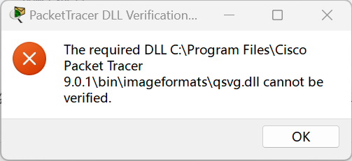

# Packet Tracer 9.0.1 — `qsvg.dll cannot be verified` 修复

> **TL;DR**：Packet Tracer 9.0.1 启动时会用 `WinVerifyTrust` 校验 DLL 签名，其中包含**证书吊销检查**。
> 国内网络把 `digicert.com` 的 CRL/OCSP 域名解析到了**不可达的 CDN 节点**，校验超时 → PT 判定"DLL 无法验证"→ 退出。
> 把 4 个域名固定到可达 IP 即可解决。**不是文件损坏、不是杀软、不是安装包问题。**


---

## 目录

- [症状](#症状)
- [快速修复](#快速修复3-步)
- [为什么会这样](#为什么会这样)
- [排查记录：走过的 6 条弯路](#排查记录走过的-6-条弯路)
- [从二进制挖出的校验逻辑](#从二进制挖出的校验逻辑)
- [定位到吊销检查](#定位到吊销检查)
- [为什么时好时坏](#为什么时好时坏)
- [复发时怎么办](#复发时怎么办)
- [其它方案](#其它方案)
- [免责声明](#免责声明)

---

## 症状



打开 Packet Tracer 9.0.1 弹出：

```
PacketTracer DLL Verification Failed

The required DLL C:\Program Files\Cisco Packet Tracer 9.0.1\bin\imageformats\qsvg.dll
cannot be verified.
```

点 OK 后程序退出。

**复现环境**：Windows 11 23H2 / Windows 10 22H2（VMware 虚拟机）、PT 9.0.1.0858、官方安装包（Cisco 签名有效）。

---

## 快速修复（3 步）

以**管理员身份**打开 PowerShell：

```powershell
# 1) 备份 hosts
$hosts = "$env:SystemRoot\System32\drivers\etc\hosts"
Copy-Item $hosts "$hosts.bak-$(Get-Date -f yyyyMMddHHmm)" -Force

# 2) 固定 DigiCert 证书服务器解析
Add-Content -Path $hosts -Value "`r`n# --- DigiCert cert endpoints for Packet Tracer ---" -Encoding ASCII
'172.66.2.5 ocsp.digicert.com',
'172.66.2.5 crl3.digicert.com',
'172.66.2.5 crl4.digicert.com',
'172.66.2.5 cacerts.digicert.com' | ForEach-Object {
    Add-Content -Path $hosts -Value $_ -Encoding ASCII
}
ipconfig /flushdns
```

**验证（必须 True 再启动 PT）**：

```powershell
$dll  = "C:\Program Files\Cisco Packet Tracer 9.0.1\bin\imageformats\qsvg.dll"
$cert = (Get-AuthenticodeSignature $dll).SignerCertificate
$ch = New-Object System.Security.Cryptography.X509Certificates.X509Chain
$ch.ChainPolicy.RevocationMode = 'Online'
"Build = " + $ch.Build($cert)
```

出现 `Build = True` 后启动 PT，弹窗消失。

**回滚**：

```powershell
$hosts = "$env:SystemRoot\System32\drivers\etc\hosts"
Get-ChildItem "$hosts.bak-*" | Sort-Object LastWriteTime -Descending | Select-Object -First 1 |
  ForEach-Object { Copy-Item $_.FullName $hosts -Force }
ipconfig /flushdns
```

> ⚠️ `172.66.2.5` 是实测可达的 Cloudflare 节点，**CDN 会变**，复发时按[复发处理](#复发时怎么办)重测。

---

## 为什么会这样

```
PT 启动
 └─ LdrRegisterDllNotification 挂钩每次 DLL 加载
     └─ 对 qsvg.dll 调 WinVerifyTrust 验签
         └─ 验签要求确认「证书未被吊销」
             └─ 按证书内的地址查 CRL / OCSP：
                  http://crl3.digicert.com/....crl
                  http://ocsp.digicert.com
                 └─ DNS 解析到不可达的 CDN 节点 → 查不到
                     └─ 返回 OfflineRevocation
                         └─ PT 判定 cannot be verified → 拒绝加载 → 退出
```

**本质：一个 DLL 能否加载，取决于一次 HTTP 请求能否到达 DigiCert 的 CDN。**

关键差异在于：

| 工具 | 是否做吊销检查 | 结果 |
|---|---|---|
| PowerShell `Get-AuthenticodeSignature` | ❌ 不查 | `Valid` |
| PT 的 `WinVerifyTrust` | ✅ 强制查 | 连不上 → 失败 |

---

## 排查记录：走过的 6 条弯路

| # | 尝试 | 结果 | 为什么无效 |
|---|---|---|---|
| 1 | 覆盖重装（同一官方包） | 仍报错 | 文件本来就正常 |
| 2 | 全新虚拟机里装 | 一模一样报错 | 同一网络 → 同一问题 |
| 3 | 取消「检查发行商证书是否吊销」 | 仍报错 | PT 调 `WinVerifyTrust` 时**显式要求**查吊销，绕过系统策略 |
| 4 | 手动导入 DigiCert 中间证书 | 仍报错 | 证书链本来完整 |
| 5 | 查杀软隔离区 / 加白名单 | 无记录 | 杀软没碰过 |
| 6 | 换安装路径 / 兼容模式 | 仍报错 | 与路径无关 |

**教训**：遇到签名校验类报错，先区分「文件问题」和「网络问题」，别急着重装。

---

## 从二进制挖出的校验逻辑

对 `PacketTracer.exe`（57 MB）做字符串分析，拿到硬编码的白名单：

```
Qt6Core.dll  Qt6Gui.dll  Qt6Svg.dll ...
qgif.dll  qjpeg.dll  qsvg.dll  qwindows.dll  qsqlite.dll
msvcp140.dll  vcruntime140.dll  vcruntime140_1.dll
libcrypto-3-x64.dll  libssl-3-x64.dll

预期签发者：
cisco systems
microsoft windows software compatibility publisher

告警文案：
SECURITY ALERT: DLL signature verification failed:
SECURITY ALERT: DLL signer mismatch:
DLL Verification Failed
The required DLL ... cannot be verified.

相关 API：
LdrRegisterDllNotification / LdrUnregisterDllNotification / WinVerifyTrust
```

由此还原流程：**挂钩 DLL 加载 → 查文件名白名单 → `WinVerifyTrust` 验签 → 比对签发者**。本案例卡在验签。

---

## 定位到吊销检查

```powershell
$ch.ChainPolicy.RevocationMode = 'Online'
$ch.Build($cert)
```

```
Build = False
  - RevocationStatusUnknown : The revocation function was unable to check revocation for the certificate.
  - OfflineRevocation       : The revocation function was unable to check revocation because the revocation server was offline.
```

---

## 为什么时好时坏

`curl --resolve` 强制指定 IP 实测：

| IP | ocsp | cacerts | crl3 | crl4 |
|---|---|---|---|---|
| `162.159.142.9` | ❌ | ❌ | ❌ | ❌ |
| **`172.66.2.5`** | ✅ 200 | ✅ 200 | ✅ 200 | ✅ 200 |
| `23.11.38.161` | ❌ | ❌ | ❌ | ❌ |

DNS 每次返回哪个节点**纯看运气**，所以有时能启动、有时报错。

---

## 复发时怎么办

```powershell
# 1) 确认问题复发
Test-NetConnection ocsp.digicert.com -Port 80 | Select-Object TcpTestSucceeded
```

若为 `False`，找一个新的可达 IP：

```powershell
# 用公共 DNS 解析，逐个试
Resolve-DnsName ocsp.digicert.com -Server 223.5.5.5 -Type A
foreach($ip in @('162.159.142.9','172.66.2.5','104.16.0.0')){
  & curl.exe -s -o NUL -w "$ip -> HTTP %{http_code}`n" --resolve ocsp.digicert.com:80:$ip --max-time 8 http://ocsp.digicert.com/
}
```

把返回 `200` 的 IP 替换进 hosts 那 4 行，再 `ipconfig /flushdns`。

---

## 其它方案

| 方案 | 可行性 | 说明 |
|---|---|---|
| hosts 固定 IP | ✅ 实测有效 | 最快、可回滚；IP 可能失效 |
| 换公共 DNS | ⚠️ 不稳定 | 实测同样会返回不可达节点 |
| 全局代理 / VPN（TUN） | ✅ 但较重 | 系统代理 PT 不一定走 |
| 升级 PT 构建 | ✅ 长期推荐 | 新版本可能不再强制吊销校验 |
| 降级 8.2.2 | ⚠️ 谨慎 | **9.x 存的 .pkt 在 8.x 可能打不开**，先备份 |

---

## 免责声明

- 本文为个人排障经验记录，**非 Cisco 官方方案**。
- 修改 hosts 会改变这几个域名的解析结果，请自行评估风险并**先备份**。
- 文中 IP 为**特定时间实测值**，CDN 节点可能变化，请按「复发时怎么办」重新测试。

## License

文档内容采用 [CC BY 4.0](https://creativecommons.org/licenses/by/4.0/) 许可。

---

## 相关链接

- **CSDN 中文版（含截图与完整排查过程）**：https://blog.csdn.net/2401_88602546/article/details/168548649
- Cisco Learning Network 上的同名问题帖：[Packet Tracer 9.0.1 Error: qsvg.dll cannot be verified](https://learningnetwork.cisco.com/s/question/0D5QO00002c1Nry0AE/packet-tracer-901-error-the-required-dll-cprogram-filescisco-packet-tracer-901binimageformatsqsvgdll-cannot-be-verified)
- 排查环境：Windows 11 23H2 + Packet Tracer 9.0.1.0858
